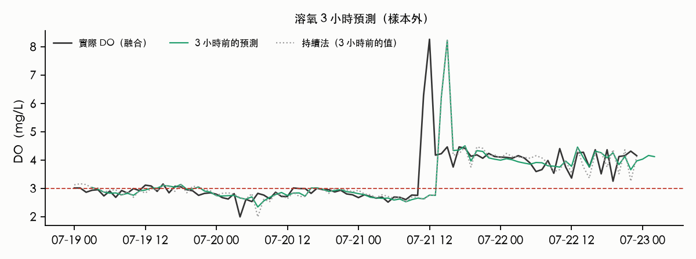

# 成效驗證報告（魚塭 pond）

> 由 `scripts/run_backtest.py` 自動產生（2026-11-06），請勿手改；改了模組後重跑。
> 樣本外期間：07/15–09/28（滾動驗證：每段只用之前的資料訓練，見 forecast/pond.py 的 FOLDS）。

## 重點

| 項目 | 結果 | 比較基準 |
|---|---|---|
| 已知故障事件（notes/eda/events.md） | **9/9 偵測到** | — |
| 合成故障 Recall | **88%**（43 次注入） | 物理範圍檢查只抓得到掉 0、超範圍 |
| 每週誤報（乾淨期間） | **3.3 次** | — |
| DO 預測 MAE（1／3／6 h） | **0.162／0.193／0.219** | 持續法 0.180／0.214／0.247（改善 10%／10%／11%） |
| 低溶氧提前預警（α = 0.3） | **77% 事件、平均提前 4.9 小時**，每週誤報 0.7 次 | 固定門檻：跌破才告警（提前 0 小時） |
| 低溶氧時數（工程估計效果） | **133 小時**（比歷史少 54%） | 歷史 290、固定門檻 142、原始探頭門檻 150 |
| 危急時數（DO < 2.5） | **15 小時**（比歷史少 87%） | 歷史 115 |
| 用電 | **1566 度** | 原始探頭門檻 1766 度（AI 省 11%） |
| 無效告警時數（DO 其實 ≥ 3.5） | **9 小時** | 原始探頭門檻 286 小時 |

**怎麼解讀**
- AI 最大的價值是「先判斷探頭可不可信」：一般 SCADA 直接用探頭原始值，DO2 劣化（8/27–9/02）與 DO3 失效（9/19–9/25）期間讀到 0，會一直誤開備用增氧機與告警；AI 自動排除故障探頭並派工維修。
- 預測讓告警提早約 5 小時，現場有時間調整投餵或準備備用機。
- 在同樣用電量下，AI 比調好的固定門檻只略好（見取捨曲線）：這個池子的低溶氧是長時間緩慢發生，增氧機全開也無法完全避免。**不誇大這一點**。

## 1. 異常診斷

### 1.1 已知事件（弱標籤）

| 事件 | 欄位 | 期間 | 偵測到 | 首次偵測 | 判定類型 |
|---|---|---|---|---|---|
| P05 | ALL | 06/23 09:00–06/23 14:00 | 是 | 06/23 09:00 | offline |
| P07 | ALL | 06/24 00:00–07/01 15:00 | 是 | 06/24 00:00 | offline |
| P09 | DO2 即時值 | 07/07 06:00–07/08 13:00 | 是 | 07/07 20:00 | sensor_drift、sensor_fault |
| P12 | pH1 即時值 | 08/09 14:00–09/02 15:00 | 是 | 08/09 19:00 | sensor_drift |
| P14 | DO2 即時值 | 08/27 21:00–09/02 14:00 | 是 | 08/29 02:00 | sensor_drift、sensor_fault |
| P17 | DO3 即時值 | 09/12 12:00–09/19 11:00 | 是 | 09/15 00:00 | sensor_drift、sensor_fault |
| P18 | OA4 氣象站 | 09/14 02:00–09/28 21:00 | 是 | 09/14 12:00 | sensor_fault |
| P19 | SC1 即時值 | 09/15 20:00–09/28 21:00 | 是 | 09/16 05:00 | sensor_drift、sensor_fault |
| P20 | DO3 即時值 | 09/19 12:00–09/25 11:00 | 是 | 09/19 08:00 | sensor_fault |

### 1.2 合成故障注入

在乾淨期間 2026-07-10–2026-08-08 的 12 支水質探頭上隨機注入 5 種故障（5 個隨機種子，每次 10 個），判斷是否在故障期間 ±3 小時內抓到同一支探頭。

| 注入故障 | 次數 | Recall | 類型正確率 | 偵測延遲中位數（h） |
|---|---|---|---|---|
| drift | 10.00 | 0.70 | 0.70 | 23.00 |
| dropout | 7.00 | 1.00 | 1.00 | 0.00 |
| offline | 6.00 | 1.00 | 1.00 | 0.00 |
| spike | 10.00 | 0.90 | 0.90 | 0.00 |
| stuck | 10.00 | 0.90 | 0.90 | 5.00 |

整體：Recall 88%、Precision 36%、類型正確率 100%、每週誤報 3.3 次。
Precision 偏低的主因是 SC 探頭本身常有短暫跳動；可信度 < 0.5 的診斷只當資料品質提示、不派工。

## 2. 溶氧預測

MAE（mg/L）：

| 模型 | 1 h | 2 h | 3 h | 4 h | 5 h | 6 h |
|---|---|---|---|---|---|---|
| 24 小時季節 | 0.286 | 0.286 | 0.286 | 0.286 | 0.286 | 0.286 |
| GBDT（本作品） | 0.162 | 0.177 | 0.193 | 0.208 | 0.214 | 0.219 |
| 持續法 | 0.180 | 0.194 | 0.214 | 0.224 | 0.234 | 0.247 |

RMSE（mg/L）：

| 模型 | 1 h | 2 h | 3 h | 4 h | 5 h | 6 h |
|---|---|---|---|---|---|---|
| 24 小時季節 | 0.482 | 0.482 | 0.482 | 0.482 | 0.483 | 0.483 |
| GBDT（本作品） | 0.274 | 0.318 | 0.337 | 0.356 | 0.360 | 0.366 |
| 持續法 | 0.304 | 0.341 | 0.364 | 0.379 | 0.388 | 0.397 |

模型：HistGradientBoosting（預測 h 小時後與現在的差，絕對誤差損失；本機缺 libomp 時自動改用 scikit-learn 的同類模型）。

低溶氧提前預警（事件＝融合 DO 由 ≥ 3 跌破 3；事件前 1–6 小時內機率 > α 即算預警）：

| α | 低溶氧事件數 | 提前預警數 | 預警率 | 平均提前小時 | 誤報（每週） |
|---|---|---|---|---|---|
| 0.1 | 39.00 | 36.00 | 0.92 | 5.78 | 2.05 |
| 0.2 | 39.00 | 32.00 | 0.82 | 5.38 | 0.84 |
| 0.3 | 39.00 | 30.00 | 0.77 | 4.90 | 0.65 |
| 0.4 | 39.00 | 26.00 | 0.67 | 4.54 | 0.19 |
| 0.5 | 39.00 | 21.00 | 0.54 | 4.90 | 0.00 |

## 3. 閉環成效（模擬 SCADA／PLC 執行）

反事實模擬（假設需人工確認的決策都被核准）：DO_sim = DO_實際 + Δ，Δ 由「策略與現場操作的台數差」累積並衰減（backtest/effect.py）。
增氧機效果有兩組：

- **工程估計**：0.13 mg/L/h、衰減 0.73（工程估計（假設 0.5 公頃、水深 1.5 m））
- **資料估計**：0.0197 mg/L/h、衰減 0.728（資料估計（817 小時，受操作時機混淆，偏低））

### 工程估計（假設 0.5 公頃、水深 1.5 m）

| 策略 | 低溶氧時數（DO<3） | 危急時數（DO<2.5） | 最低 DO | 增氧機用電（度） | 電費（元） | 備用機啟動時數 | 告警次數 | 無效告警時數 | 操作切換次數 |
|---|---|---|---|---|---|---|---|---|---|
| 歷史實際 | 290 | 115 | 2 | 1324 | 5296 | 0 | 0 | 0 | 58 |
| 固定門檻（原始探頭） | 150 | 15 | 2 | 1766 | 7065 | 562 | 27 | 286 | 105 |
| 固定門檻 | 142 | 15 | 2 | 1569 | 6275 | 302 | 22 | 0 | 97 |
| AI 決策 | 133 | 15 | 2 | 1566 | 6265 | 352 | 36 | 9 | 154 |

### 資料估計（817 小時，受操作時機混淆，偏低）

| 策略 | 低溶氧時數（DO<3） | 危急時數（DO<2.5） | 最低 DO | 增氧機用電（度） | 電費（元） | 備用機啟動時數 | 告警次數 | 無效告警時數 | 操作切換次數 |
|---|---|---|---|---|---|---|---|---|---|
| 歷史實際 | 290 | 115 | 2 | 1324 | 5296 | 0 | 0 | 0 | 58 |
| 固定門檻（原始探頭） | 269 | 101 | 2 | 1852 | 7408 | 674 | 13 | 301 | 78 |
| 固定門檻 | 268 | 101 | 2 | 1626 | 6506 | 375 | 14 | 0 | 81 |
| AI 決策 | 267 | 101 | 2 | 1588 | 6354 | 384 | 25 | 0 | 152 |

### 3.1 再學習（調整 α、β）

在 7/15–7/31 找成本最低的參數（成本＝低溶氧時數 × 100 元＋危急時數 × 300 元＋電費），到 8/01 之後驗證：

- 選到 α = 0.1、β = 0.02
- 驗證期成本：歷史實際 59,004、固定門檻（原始探頭） 22,006、固定門檻 20,770、AI 決策 20,536
- 是否優於所有基準：**是 → decide/params.json 設為 validated：DO 已低於門檻的增氧（風險低）自動執行；只是預測會低（風險中）仍需人工確認**

## 4. 狀態辨識

## 5. 限制與待確認

- 企業沒有維修紀錄（Q1），異常偵測用已知事件＋合成故障評估。
- 增氧機台數、池子面積未知（Q5），閉環效果依工程估計，並附資料估計的保守結果；資料估計受操作時機混淆，偏低。
- 備用增氧機、暫停投餵在資料中沒有對應欄位，模擬時把備用機視為與主機相同效果。
- 低溶氧門檻 3.0 mg/L 依此池資料分布訂定，物種與企業標準待確認。
