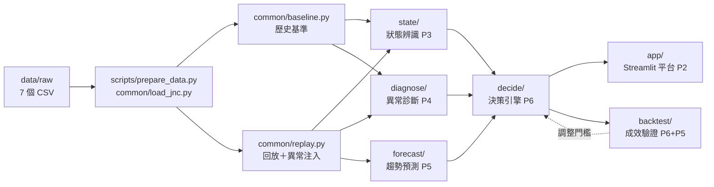

# 系統架構

> 依企業命題頁與兩張流程圖整理（2026-10-09），細節說明見 [AI 分析與 6 人分工規劃 v2](銘祥科技命題_AI分析與6人分工規劃_v2.pdf)。
> 介面（第 4 節）在里程碑 M1（10/18）前由全員定稿，定稿後修改要在週會提出。
> 2026-10-11 依參賽進度分析報告更新：閉環定位（第 1 節）、技術路線（第 6 節）、合規模型清單（第 7 節）。

## 1. 命題分工

| 分工 | 內容 | 誰負責 |
|---|---|---|
| 資料 | IoT 智慧感測大數據：感測器、設備、環境氣象、維修紀錄（7 個 CSV） | 銘祥提供 |
| AI | 數據分析、辨識、預測、診斷，回答三個問題，轉成「可執行的決策」 | 參賽團隊 |

三個問題：**現在發生什麼事？接下來可能發生什麼事？現在應該採取什麼行動？**

本作品**不自建感測器或控制硬體**。企業流程的「執行」由 SCADA／PLC 或人工負責，我們用軟體模擬執行與歷史回測完成「結果回傳與成效驗證」。

**閉環定位（與參賽進度分析報告對齊）**：報告建議的感測層是「ESP32 低價模組，**或**以資料回放器重播銘祥 CSV」，本作品採後者。11/15 的閉環 demo 是**軟體閉環**：回放器（`common/replay.py`）→ AI → 標準決策資料 → 工單／推播 → 模擬 SCADA／PLC 執行 → 回測。ESP32 接繼電器帶動打氣馬達只是決賽加分的**選配**（D5，任務 A4），不在關鍵路徑上；MQTT 也只在做實機時才需要。

## 2. 企業要的五項輸出與規格

| 輸出 | 企業列出的內容 | 模組 | 負責 |
|---|---|---|---|
| 狀態辨識 | WQI／GI、燈號、感測器可信度 | `state/` | P3 |
| 異常診斷 | 可能原因、判斷證據、診斷可信度 | `diagnose/` | P4 |
| 趨勢預測 | 超標時間、設備故障機率 | `forecast/` | P5 |
| 行動控制 | 設備、動作、時間、幅度 | `decide/` | P6 |
| 管理優先 | 工單、派工、備品與能耗 | `decide/` | P6 |

- **標準決策資料**（每筆決策 9 欄）：設備、動作、時間、幅度、理由、預期效果、風險、人工確認、Fallback
- **安全控制原則**：AI 提出決策 → SCADA 呈現、告警與管理流程 → PLC 保留安全連鎖與緊急控制
- **執行模式分級**：低風險且已驗證可自動執行；高風險要人工確認；系統失效時走 Fallback 安全規則

## 3. 分層與資料流



| 層 | 內容 | 資料夾 | 負責 |
|---|---|---|---|
| 資料層 | 讀檔、格式整理、資料字典、歷史基準、回放模擬器 | `common/`、`scripts/`、`data/` | P2 |
| 分析層 | 狀態辨識、異常診斷、趨勢預測 | `state/`、`diagnose/`、`forecast/` | P3、P4、P5 |
| 決策層 | 目標、規則、風險、成本 → 標準決策資料 → 執行分級；LLM 工單 | `decide/` | P6 |
| 呈現層 | Streamlit：燈號、診斷卡、預測曲線、決策卡、工單、回測頁 | `app/` | P2 |
| 驗證層 | 照 AI 建議做 vs 不做／固定門檻，比較低溶氧時數、能耗、誤報 | `backtest/` | P6、P5 |

## 4. 模組介面（魚塭第一版已實作，2026-10-20）

每個模組是一個 Python 函式，輸入一段時間的 DataFrame（index 為時間、已用 `common.clean.clean()` 清洗），輸出 dict（可轉 JSON）。
草案的欄位都保留，第一版多了幾個欄位（下方粗體）；之後擴充場域也照這個格式。

```python
state(df, site) -> {"ts", "site", "wqi", "light", "sensor_trust": {欄位: 0–100},
                    **"light_text", "values": {DO, pH, ORP, SC, temp}, "probes_used", "aerator_on", "power_w",
                    "device_health", "offline"**}
diagnose(df, site) -> [{"ts", "type", "target", "evidence": [...], "confidence", **"cause", "duration_h"**}]
forecast(df, site, model) -> {"ts", "target", "h1", "h3", "h6", "hours_to_threshold", "fail_prob",
                              **"now", "path", "p_low", "threshold", "fail_target", "probe_rul"**}
decide(state, diagnoses, forecast) -> [標準決策資料 9 欄 + **類別、執行模式、優先級、能耗_kWh、編號**]
```

`diagnose` 的 `type`：`sensor_fault`、`sensor_drift`、`water_event`、`equipment_fault`、`offline`、`power_low`（河川用），第一版另有 `multivariate`（Isolation Forest）。
`forecast` 的 `fail_prob` 是「探頭在 48 小時內超出容許差的機率」（取最高的一支，`fail_target` 為哪一支）；DO 低於門檻的機率是 `p_low`。

整條閉環在 `common/pipeline.py`（`PondPipeline.build().step(ts)`），流程圖 5 個階段對應：

| 企業流程圖 | 程式 |
|---|---|
| 01 IoT 感測 | `common/replay.py`（回放器、合成故障注入） |
| 02 大數據 | `common/clean.py`、`common/baseline.py` |
| 03 AI 分析 | `state/pond.py`、`diagnose/pond.py`、`forecast/pond.py` |
| 04 決策引擎 | `decide/engine.py`、`decide/workorder.py` |
| 05 執行回饋 | `backtest/closed_loop.py`（模擬 SCADA／PLC、回測）、`backtest/feedback.py`（執行紀錄寫檔、結果驗證、依回饋再學習 α、β）、`app/streamlit_app.py` 的人工確認、執行回饋頁與「重新學習」按鈕 |

標準決策資料範例：

```json
{
  "設備": "1 號增氧機",
  "動作": "啟動",
  "時間": "立即，持續 2 小時",
  "幅度": "全速",
  "理由": "預測 3 小時後 DO 降至 2.6 mg/L；三支探頭同步下降，判定為真實水質事件（可信度 0.9）",
  "預期效果": "2 小時內 DO 回升至 4 mg/L 以上",
  "風險": "中",
  "人工確認": false,
  "Fallback": "DO 資料中斷超過 1 小時：維持增氧機運轉並通知值班人員"
}
```

## 5. 場域範圍

| 場域 | 代號 | 定位 | 主要用途 |
|---|---|---|---|
| 專家系統（魚塭） | `pond` | 核心，五項輸出全做 | 三探頭可信度、DO 預測、低氧決策、用電判斷增氧效果 |
| 三爺宮溪（河川站） | `river` | 擴充 | 污染事件 vs 感測器異常、電池耗盡預測 |
| 羊舍 | `goat` | 擴充 | THI 熱緊迫、與實際帆布／風扇操作紀錄比對 |
| 育成北側 | `yucheng_north` | 加分 | 設備健康：斷線、重開機、4G 劣化 |
| 育成一廠、東北角、工地微氣候 | `yucheng1`、`northeast`、`construction` | 加分 | 空品與熱危害燈號、超標預測 |

各場域欄位、期間、缺漏與異常值見 [data-dictionary.md](data-dictionary.md)。

## 6. 技術選型與限制

- Python 3、pandas、scikit-learn（Isolation Forest、PCA）、LightGBM、SHAP、ruptures（PELT）、Streamlit、Plotly
- 時間序列一律依時間先後切分（前 80% 訓練、後 20% 測試），不可隨機切
- 每個功能都要有基準比較：persistence、固定門檻、不採取行動

| 任務 | 基準（必做） | 主力 | 進階（選做） |
|---|---|---|---|
| 感測器故障 | 物理範圍、卡值、Hampel 跳點 | 三探頭中位數投票＋殘差 | — |
| 多變量異常 | 固定門檻 | Isolation Forest＋PCA T²／SPE（附貢獻圖） | LSTM 自編碼器 |
| 漂移與變化點 | — | CUSUM、EWMA、PELT | — |
| 溶氧預測 1–6 h | 持續法、24 h 季節基準 | LightGBM 多步＋分位數迴歸 | Chronos-2 零樣本 |
| 預測維護 | 斜率欄位趨勢圖 | 退化趨勢擬合 → 剩餘可用時間 | 卡爾曼濾波 |
| 故障原因診斷 | 規則樹 | 決策樹／梯度提升＋SHAP | — |
| 決策 | 規則表 | 風險式：P(DO<門檻)>α 即行動，兼顧電費 | 簡易 MPC 增氧排程 |

成果數字：預測報 MAE／RMSE 與提前預警時數；異常偵測報合成異常的 Precision／Recall 與每週誤報次數。

## 7. LLM 與合規模型清單

LLM 只負責把判斷結果寫成可執行的工單與白話說明，判斷由規則與模型決定；不讓 LLM 直接讀 CSV 判斷異常、不讓它未經規則把關就下控制指令、不需要微調。LLM 輸出的數字必須出現在工具回傳值中，否則改用範本（數字守門員）。

| 硬體 | 可用模型（皆非中資） | 用途 |
|---|---|---|
| CPU 筆電、16 GB RAM | Gemma 4 E4B、Granite 4.0 H-Tiny、Ministral 3 3B | 決賽離線備援、工具呼叫 |
| 8–12 GB 顯卡 | Gemma-3-TAIDE-12b-Chat-2602、Gemma 4 12B、Ministral 3 8B／14B | 中文工單 |
| 16–24 GB 顯卡 | gpt-oss-20b、Gemma 4 26B-A4B | 實驗室主機 |
| 嵌入與時序 | EmbeddingGemma-300m、multilingual-e5、Granite Embedding；Chronos-2、Granite TTM | RAG、零樣本預測 |

雲端 API（Gemini、OpenAI、Claude）可作為備案，但決賽需能離線執行。

**禁用**：DeepSeek（含所有 R1-Distill）、Qwen 及其微調、GLM、Kimi、MiniMax、Yi、InternLM／InternVL、BGE／BAAI 嵌入與重排、阿里 GTE、清華 Timer／Sundial；平台避開 RAGFlow、FastGPT、Xinference、LMDeploy、Dify。

**兩個陷阱**：Llama-Breeze2（聯發科）的視覺編碼器是 InternViT-300M，屬中國來源元件，**不可用**；Llama-3.1-TAIDE-R1-8B-Chat 合併了 DeepSeek-R1-Distill 權重，**不可用**。TAIDE 模型需同意授權條款才能下載，要在說明書的 AI 工具揭露中註明。
