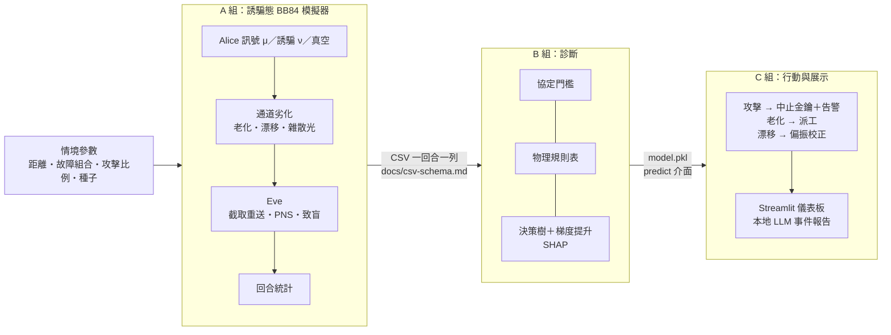

# 專案計畫

> 建立：2026/10/8，資料夾版整理：2026/10/11；**2026/10/11 依參賽進度分析報告改版**（[ADR-0004](adr/0004-pivot-to-link-health-diagnosis.md)）。
> 線上協作版 [Claude Docs 專案計畫](https://claude.ai/code/artifact/2bbc5570-12fb-4c18-bad4-d83290e0a303) 仍是改版前的三類方案，以本檔為準。
> 時程以 [schedule/tasks.csv](../schedule/tasks.csv) 為準，本文件不重複列日期。

## 題目與核心論點

**QKD 鏈路 AI 健康診斷：分辨量子竊聽與通道劣化**

**物理知識決定看什麼，AI 決定怎麼組合：多特徵診斷能分辨通道劣化與攻擊類型，並看見 QBER 門檻完全看不到的 PNS 與偵測器致盲攻擊。**

為什麼不是原本的「分辨雜訊與竊聽」（報告 4.2.1 的模擬驗證）：

| 實驗 | 結果 | 意義 |
|---|---|---|
| E1 雜訊 1–6% vs 全攔截 | 深度 1 的決策樹也 100%，切點 14.3% | AI 只重新發現協定門檻 |
| E2 逐光子標記 | AUC 0.61 | 物理上限 → 一律以「回合」為單位 |
| E3 雜訊緩升＋攔截 10% | 固定門檻 29%、追蹤基準線 93% | 進步來自基準線，所以基準線必須是比較對象 |
| E4 總 QBER 同為約 6% | 只看 QBER 53.5%；加兩基底錯誤率差 100% | 多特徵才是 AI 的用武之地 |

AI 的定位是「**提早預警、分辨原因、減少誤中止**」，金鑰安全仍由協定中止門檻保證。說明書與簡報**不可寫「AI 讓 QKD 更安全」**。緩慢加量的 Eve 原理上分不出來（會被基準線當成老化吸收），要寫成限制。

## 團隊

| 組別 | 成員（科系） | 負責 |
|---|---|---|
| A 通訊組 | 許程景（電機）、林子桀（智慧自動化）、周冠辰（智慧自動化） | `sim/` 誘騙態 BB84 模擬器、資料集 |
| B 機器學習組 | 王端宏（電機）、何名綸（資工，兼任 PM） | `ml/` 基準線、規則表、七類診斷 |
| PM | 范語芸（通訊） | `app/` 儀表板與行動、影片、對外聯繫 |

每項任務的主責與協助人見 [team.md](team.md) 與甘特圖「人員分工」區（組內分配待 D13 確認）。

## 系統架構

三組只透過兩個介面交接：**CSV 欄位規格**（[csv-schema.md](csv-schema.md)、`common/schema.py`）與 **`model.pkl` 的 predict 介面**。

## 分兩階段

| 階段 | 期限 | 內容 | 標籤 |
|---|---|---|---|
| 一 | 10/25 | 基本 BB84＋截取重送、光纖老化、對準漂移；協定門檻 vs 基準線 vs 決策樹比較表 | 4 類 |
| 二 | 11/8 | 加入誘騙態、雜散光、PNS、偵測器致盲；七類診斷、同誤報率比較、留一攻擊驗證、SHAP | 7 類 |

10/31 檢查點：階段一未完成就停在階段一，階段一本身仍是一件完整的作品。

## 程式目錄對應

| 目錄 | 負責 | 內容 |
|---|---|---|
| `common/` | A＋B | `schema.py`：CSV 欄位與七類標籤的唯一定義 |
| `sim/` | A 組 | `bb84.py` 協定與誘騙態、`channel.py` 劣化、`eve.py` 攻擊、`generate_dataset.py` 回合輸出；`reference/` 放老師的參考程式 |
| `ml/` | B 組 | `fake_data.py`、`features.py`、`baseline.py`（門檻、基準線、規則表）、`train.py`、`evaluate.py` |
| `app/` | C 組 | `dashboard.py` Streamlit 儀表板與行動 |
| `data/`、`models/`、`reports/` | 產出 | 不進 git（reports 的圖放進說明書） |
| `tests/` | 各組 | pytest 單元測試 |

## A 組（通訊）：誘騙態 BB84 模擬器

1. **階段一**：單光子 BB84 → 基底比對 → QBER（含 Z、X 分開）；截取重送、光纖老化、偏振對準漂移
2. **階段二**：弱相干光源，脈衝隨機選訊號 μ≈0.5、誘騙 ν≈0.1、真空，光子數依卜瓦松分布；加入雜散光、PNS、偵測器致盲
3. **真實化**（必做）：有限統計（每回合脈衝數不能太多）、良性故障隨機並存、攻擊只作用於部分時間或光子
4. **驗證**：以文獻已知行為做單元測試（無雜訊 QBER≈0、全截取重送≈25%、PNS 時誘騙比約 0.20→0.13）；公式每週給指導老師檢查一次
5. **輸出**：一回合一列 CSV；不得含答案欄位以外的洩漏資訊；另用不同種子產生未見過測試集

## B 組（機器學習）：診斷與比較

1. 第一週用 `ml/fake_data.py` 把流程寫完，不等 A 組
2. **三種基準**（必做）：協定門檻 QBER>11%、指數平滑基準線、物理規則表
3. **模型**：決策樹（可解釋）＋梯度提升；七類多類別分類
4. **比較方式**：相同誤報率（10%、5%、2%）下各攻擊的偵測率；依 `attack_ratio` 分段
5. **泛化**：留一攻擊驗證（訓練時拿掉一種攻擊）；只用良性資料訓練的逐項 z 分數異常偵測
6. **解釋**：SHAP、決策樹圖、混淆矩陣
7. **誠實呈現**：規則在單一特徵（PNS）可能略勝，ML 在狀況並存時較好；結論是規則＋ML 並用。老師模擬的參考數字：真實條件下梯度提升七類準確率 0.832，學生需以自己的程式重新產生

## C 組（展示與應用）

1. **儀表板**（Streamlit）：側欄選故障與攻擊；主畫面即時 QBER 與誘騙比曲線、七類診斷＋信心度、協定門檻判斷並排
2. **行動**：攻擊 → 中止金鑰並告警；老化 → 派工檢修；漂移 → 偏振校正
3. **事件報告**：本地 LLM（Gemma 4 E4B 或 Gemma-3-TAIDE-12b-Chat-2602，非中資）只引用程式算出的數字
4. 決賽必須能在單一筆電離線執行；另部署雲端版給初賽線上展示
5. 若與 JNC-AIoT 同隊，可共用 JNC 的 Streamlit 版型與 LLM 呼叫模組，核心偵測程式不可共用

## 風險與對策

| 風險 | 後果 | 對策 |
|---|---|---|
| 物理模型寫錯 | 結果不可信 | 每週公式檢查；以文獻已知行為做單元測試 |
| 大一對誘騙態的理解門檻 | 階段二做不完 | 兩階段推進；階段一即可成立作品 |
| 模擬過於乾淨、出現 100% | 評審認為「寫幾條規則就好」 | 強制有限統計、故障並存、弱攻擊 |
| 逐光子標記或標籤洩漏 | 成績虛高、被評審抓到 | 一律以回合為單位；`check_no_leakage` 擋住答案欄位 |
| 評審質疑「AI 讓 QKD 更安全」 | 表達失分 | 依上方「定位」撰寫說明書與 Q&A |
| 與主攻作品（JNC-AIoT）搶人力 | 兩邊都做不好 | decisions-pending.md D2：6 人已是隊伍上限，同隊就要兩件一起排人力 |
| PM 負荷集中（范語芸、何名綸） | 文件與展示延誤 | A 組 11/8 後轉支援影片與說明書；見 [team.md](team.md) 人力調度 |
| 決賽現場設備問題 | 展示失敗 | 離線版＋備援影片 |
